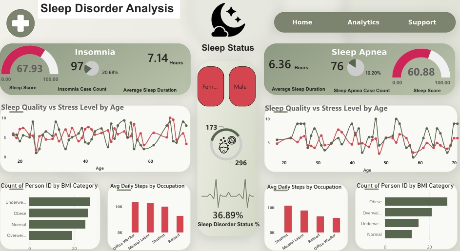

# Sleep Disorder Analysis Dashboard

## Executive Summary
This Power BI project explores sleep-related measures and recorded sleep-disorder categories in a synthetic dataset of 469 records. The dashboard compares records labelled **Insomnia** (97 records; 20.68%) and **Sleep Apnea** (76 records; 16.20%), including average sleep duration, a weighted Sleep Score, sleep quality and stress patterns, BMI-category counts, and average daily steps by occupation.

The analysis is descriptive and exploratory. Because the dataset is synthetic, its patterns should not be interpreted as clinical evidence or used to guide diagnosis or treatment.

## Business Problem & Objectives
**Problem statement:** How can an interactive dashboard make patterns in sleep duration, sleep quality, stress, BMI category, occupation, and recorded sleep-disorder status easier to explore in a synthetic population?

**Objectives**
1. Summarize the number and share of records labelled Insomnia and Sleep Apnea.
2. Compare average sleep duration and the dashboard's weighted Sleep Score between the two disorder groups.
3. Explore how sleep quality and stress levels vary across age.
4. Compare BMI-category counts and average daily steps by occupation within each disorder group.
5. Enable exploratory filtering by gender.

## Business Questions Answered
1. How many records are labelled Insomnia or Sleep Apnea, and what share of all 469 records does each group represent?
2. How do average sleep duration and the dashboard's weighted Sleep Score compare between the two groups?
3. How do recorded sleep-quality and stress values vary across age within the displayed groups?
4. How are BMI categories distributed among records labelled Insomnia and Sleep Apnea?
5. How does average daily step count vary by occupation within each disorder group?
6. How can the displayed measures be explored by gender?

## Dataset Overview
- **Source file:** `SleepDisorder_Dataset.csv`
- **Size:** 469 records and 10 columns
- **Record structure:** One row per synthetic person record; Person ID is unique in the supplied file.
- **Key fields:** Person ID, Gender, Age, Occupation, Sleep Duration (hours), Quality of Sleep (scale: 1–10), Stress Level (scale: 1–10), BMI Category, Daily Steps, Sleep Disorder.
- **Sleep Disorder values:** Insomnia, Sleep Apnea, and blank values. In this analysis, blank values are described as **no recorded disorder**, because the source does not establish whether they mean no disorder or not assessed.

## Tools & Technologies
- Microsoft Power BI Desktop
- DAX measures
- Power Query
- CSV data source

## Key Metrics Displayed
| Metric | Dashboard value | Interpretation |
|---|---:|---|
| Insomnia records | 97 | 20.68% of all 469 records |
| Insomnia average sleep duration | 7.14 hours | Rounded mean for the Insomnia group |
| Insomnia Sleep Score | 67.93 | Weighted score; reproduced from the CSV (67.9268 before rounding) |
| Sleep Apnea records | 76 | 16.20% of all 469 records |
| Sleep Apnea average sleep duration | 6.36 hours | Rounded mean for the Sleep Apnea group |
| Sleep Apnea Sleep Score | 60.88 | Weighted score; reproduced from the CSV (60.8829 before rounding) |
| Overall sleep-disorder status | 36.89% | 173 of 469 records have a nonblank Sleep Disorder value |

The disorder percentages use the full dataset (469 records) as the denominator. Among the 173 records with a recorded disorder, 56.07% are labelled Insomnia and 43.93% Sleep Apnea.

## Sleep Score Methodology
The dashboard uses a DAX weighted composite measure. The Insomnia measure shown in Power BI is:

```DAX
Insomnia Sleep Score =
CALCULATE(
    (
        0.4 * AVERAGE(SleepDisorder_Dataset[Quality of Sleep (scale: 1-10)]) / 10
        + 0.4 * AVERAGE(SleepDisorder_Dataset[Sleep Duration (hours)]) / 8
        + 0.2 * (10 - AVERAGE(SleepDisorder_Dataset[Stress Level (scale: 1-10)])) / 10
    ) * 100,
    SleepDisorder_Dataset[Sleep Disorder] = "Insomnia"
)
```

The Sleep Apnea measure uses the same weighted calculation with the filter changed to `Sleep Apnea`.

Weights: sleep quality 40%, sleep duration 40%, and inverse stress level 20%. This is a project-defined composite score, not a validated clinical scale. The displayed scores (67.93 and 60.88) were independently reproduced from the CSV using this formula (67.9268 and 60.8829 before rounding). The score is calculated from group averages, and its duration term (divided by 8) is uncapped.

## Key Insights & Observations
1. **Recorded disorder status:** 173 of 469 records (36.89%) contain a nonblank disorder value: 97 Insomnia and 76 Sleep Apnea. The meaning of blank values is not explicitly defined by the source.
2. **Sleep duration differs by group:** Average duration is 7.14 hours for Insomnia and 6.36 hours for Sleep Apnea. The no-recorded-disorder group averages 7.64 hours in the source-data verification. These are descriptive comparisons only.
3. **Sleep quality differs by group:** On the source field's 1–10 scale, average Quality of Sleep is 5.78 for Insomnia, 5.21 for Sleep Apnea, and 6.05 for records with a blank disorder field. These values are distinct from the dashboard's weighted Sleep Score.
4. **Stress and sleep quality show little overall linear association:** The Pearson correlation calculated across all records was approximately -0.021. This does not support claiming that the dashboard demonstrates stress causes lower sleep quality.
5. **BMI profile:** 28 of 76 Sleep Apnea records (36.84%) are in the Obese category, compared with 27.72% of all records. This is an exploratory distribution, not evidence that BMI caused a disorder.
6. **Daily steps:** Average daily steps were approximately 7,225 for Sleep Apnea records, 9,805 for Insomnia records, and 10,608 for records with a blank disorder field. Occupational subgroups are small, so their averages should be interpreted cautiously.

## Recommendations & Next Steps
- **Improve visual clarity:** Keep the corrected Sleep Apnea card label and the “Sleep Disorder Status %” label on the 36.89% KPI (it equals 173 ÷ 469, the share of records with a nonblank Sleep Disorder value).
- **Clarify chart titles and legends:** The line chart uses individual ages on the x-axis, so use “Sleep Quality vs. Stress Level by Age” unless actual age bands are created. Add a legend identifying each line.
- **Fix truncated labels:** Ensure “Female” and “Underweight” are fully visible.
- **Review duplicate-content rows:** Six pairs of records were reported as identical across all fields except Person ID. Check the source and document whether these are intentional or accidental before removing any.
- **Document measures:** Keep the DAX definitions and denominator rules with the project. Verify that percentage measures behave as intended when the gender slicer is used.
- **Improve comparison:** Consider adding the no-recorded-disorder group and sample sizes to relevant visuals, where appropriate.
- **Avoid clinical claims:** Do not use the dashboard to diagnose, recommend treatment, or claim causation. A real-world study would require suitable real data, ethical approvals where applicable, and qualified clinical/research oversight.

## Dashboard Preview
``

## Repository Structure
```text
sleep-disorder-analysis/
├── data/
│   └── README.md                  # Explain data source and access; avoid publishing sensitive data
├── dashboard/
│   └── Sleep_Disorder_Analysis.pbix
├── images/
│   └── sleep-disorder-dashboard.png
├── docs/
│   └── project-report.md
└── README.md
```

## Data Limitations & Disclaimer
- The dataset is synthetic and does not represent verified real patients.
- Blank Sleep Disorder values are interpreted as “no recorded disorder”; the source does not confirm whether they mean no disorder or not assessed.
- Six pairs of records were reported to match across all columns except Person ID. Their status should be reviewed; they have not been removed in this analysis.
- The dashboard's weighted Sleep Score is a project-defined metric, not a validated clinical score. Its displayed values were independently reproduced from the CSV, but it is average-based and its duration term is uncapped.
- Analysis is descriptive. No significance testing was performed, and no causal conclusions should be drawn.
- The dashboard is for portfolio demonstration and learning only, not for clinical decision-making.

## Future Improvements
- Consider capping the duration component at 100% and documenting the score's average-based design.
- Confirm how the 36.89% KPI and the percentage cards behave under the gender slicer.
- Add a legend and accurate age-axis wording to the line charts.
- Review duplicate-content records and document the decision.
- Add clearer denominator and sample-size information to group comparisons.
- If appropriate, include the no-recorded-disorder group as a comparison baseline.
